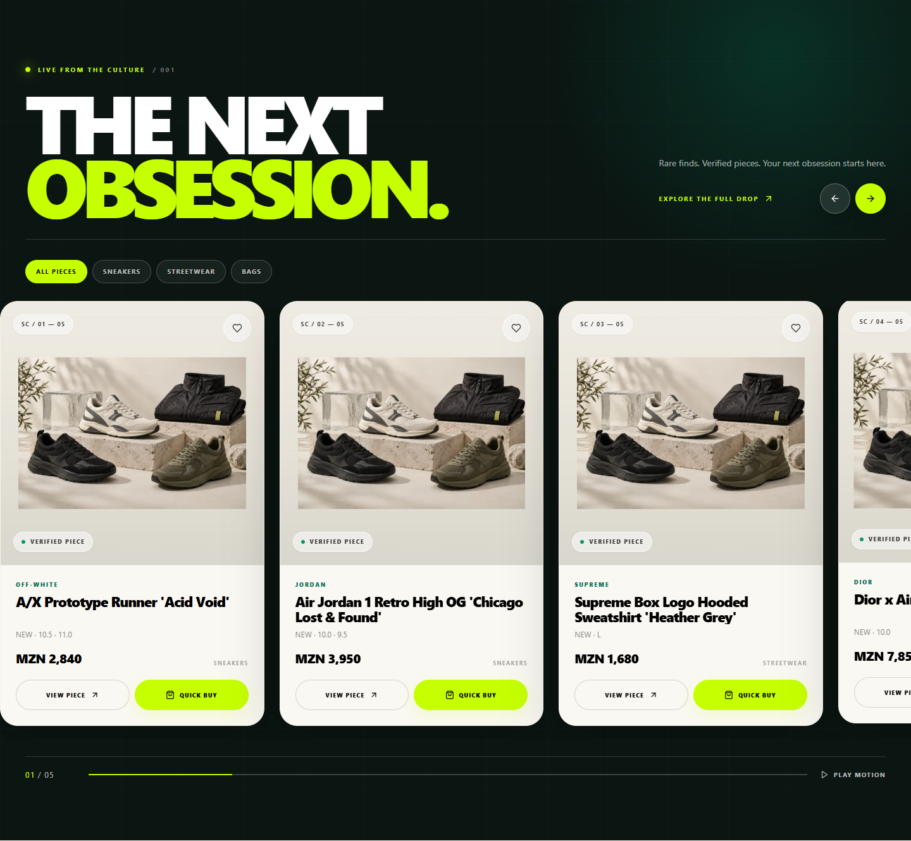

# Premium Carousel Implementation Report

## Outcome

The homepage product rail has been rebuilt as **The Moving Archive**, a premium, horizontal product carousel backed by the existing Supabase catalog. It preserves the storefront's established emerald, acid-lime, and warm-neutral direction while making the product itself the focal point.

## Product and data integration

- Uses the existing live storefront product query and its current most-wanted, featured, and newest-product ordering.
- Renders only real eligible storefront records; no placeholder or invented products were added.
- Keeps the exact listing and product identifiers used by product detail, wishlist, quick-buy, bag, and checkout flows.
- Retains category filters and derives them from the available catalog facets.
- Keeps price display in the shopper's resolved MZN checkout currency while preserving the international pricing pipeline implemented by the catalog import work.

## Design implementation

- Each product is presented as a two-zone editorial card: a square, object-contained image stage above a separate warm-white information panel.
- Product names, condition, available sizes, category, and price stay outside the photography so the source image is never obscured.
- Verified status, archive numbering, wishlist, and primary actions remain visible without competing with the image.
- Responsive card sizing presents three cards plus a partial next card on wide desktop, two plus a partial card on tablet, and one plus a partial card on mobile.
- The section uses native CSS scroll snapping instead of adding another carousel dependency.

## Interaction and accessibility

- Supports mouse dragging, touch swiping, keyboard arrow navigation, Home/End keys, and explicit previous/next controls.
- Autoplay advances approximately every five seconds and pauses during hover, keyboard focus, pointer interaction, off-screen visibility, or a hidden browser tab.
- The motion control and `prefers-reduced-motion` support disable automated movement when requested.
- Progress and current/total counts are derived from the real number of products and the active responsive viewport.
- Navigation is clamped when the filtered result set cannot safely loop; controls correctly disable for small result sets.
- Buttons retain distinct accessible labels and the rail remains usable without a mouse.

## Commerce integrity

- **View piece** routes to the selected product's real detail page.
- **Quick buy** adds the selected listing, including its actual listing ID, to the existing bag and checkout flow.
- Wishlist state continues to use the existing storefront persistence behavior.
- Card click handling was tuned so drag gestures cannot trigger accidental navigation while ordinary button clicks remain reliable.

## Visual evidence

Desktop, 1440 × 900:

Mobile, 390 × 844:

## Verification

| Check             | Result                                                  |
| ----------------- | ------------------------------------------------------- |
| ESLint            | Passed with no warnings or errors                       |
| TypeScript        | Passed                                                  |
| Unit tests        | 38 passed, 29 opt-in Supabase integration tests skipped |
| Production build  | Passed; 71 routes generated                             |
| Playwright E2E    | 18 passed in the final single-worker run                |
| Desktop visual QA | 1440 × 900 verified                                     |
| Mobile visual QA  | 390 × 844 verified with no horizontal page overflow     |

The browser suite also covers 390, 430, and 768-pixel layouts, carousel navigation and autoplay pausing, filters, reduced motion, product navigation, quick buy, checkout mocks, customer routes, admin publication, and mobile overflow. The responsive CSS rules extend the same tested behavior through the requested 375–1920-pixel range.

## Remaining content dependency

The carousel deliberately does not fabricate inventory. Production will show real cards only when products have eligible published listings, stock, prices, and media. Visual quality therefore depends on the uploaded source photography and the publication state of the production catalog.
